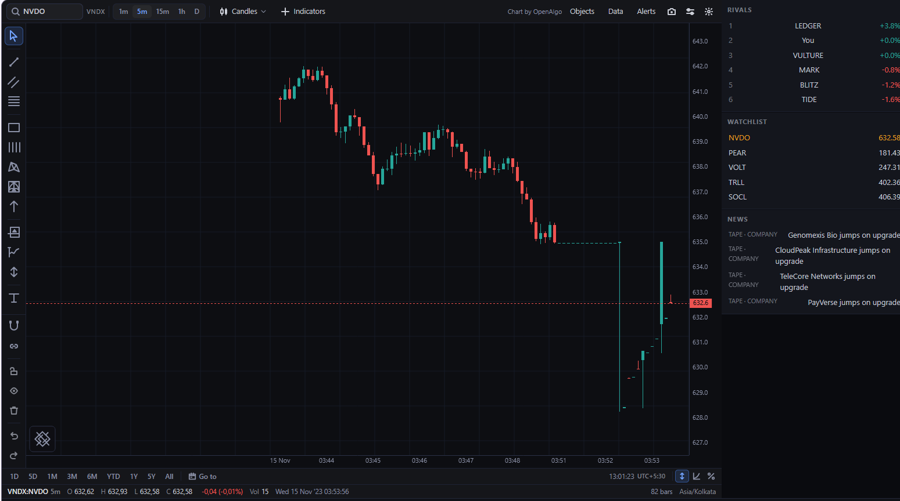
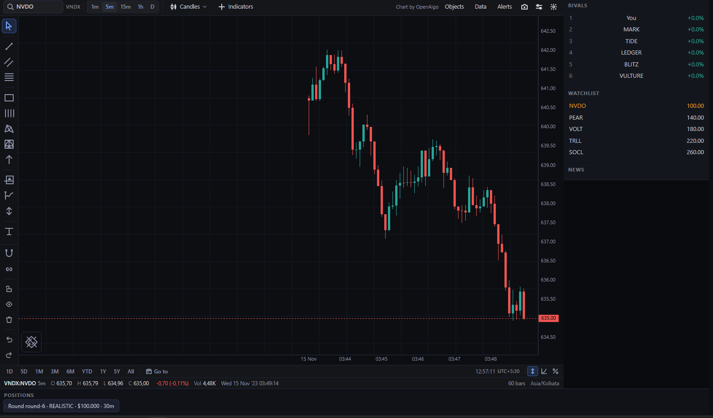

# VirtualInvestor

A self-contained, realistic intraday trading game — free software forever
([GPL-3.0-or-later](LICENSE)). A deterministic market simulation runs on a Java
server; you trade a live market against rival bots and bank market-makers, solo
or with friends in lobby rooms. Sessions are durable and resumable.




## What you get

- **A market that behaves like one**: 21 instruments, laddered order books,
  toxicity-aware market makers that fade and requote, momentum/value/scalper
  rivals, a news-reading hunter and a macro desk that trade headlines with
  human-like delay — plus earnings surprises, rumors that confirm or deny, and
  volatility that clusters.
- **Real trading**: market, limit, stop and stop-limit orders over a live
  socket, fees and buying-power guards, short selling with policy, margin
  floors, circuit breakers, per-symbol realized gains and fill history with
  markouts.
- **Multiplayer rooms**: lobby with live games, 6-seat rooms, master start,
  backfill bots for empty seats, locked rosters once the clock runs.
- **Deterministic**: same seed, same market — every session is reproducible,
  and bot economics are baselined in `docs/calibration.md`.

## Prerequisites

- Java 21 (JDK) and Maven 3.9+
- Node.js 20+ and npm
- Docker with the Compose plugin (for PostgreSQL)

## Install and run

**1. Database** (required by the server):

```bash
cd infra && docker compose up -d db
```

**2. Server** — from the repo root, install the modules once, then start the edge:

```bash
cd server && mvn -q install -DskipTests
cd edge && VI_ADMIN_PASSWORD=choose-a-password mvn spring-boot:run
```

The API listens on `http://localhost:8080`. `VI_ADMIN_PASSWORD` is the
game-master password (used to approve players and settle rounds early) — pick
your own; without it nobody can approve accounts.

**3. Web terminal** — in a second terminal:

```bash
cd web && npm install
npm run dev
```

Open `http://localhost:5173/`.

## Play your first game

1. **Register** on the login page (pick a bank — it sets your fee tariff),
   then approve the account: open `http://localhost:5173/admin.html`, log in
   with your `VI_ADMIN_PASSWORD`, and approve the player.
2. **Log in** → you land in the **lobby**, listing live games.
3. **Single-player session**: pick capital / length / preset and start — the
   terminal opens and the clock runs at once.
4. **Trade** NVDO (or click any watchlist row to chart PEAR, VOLT, TRLL,
   SOCL): set quantity in the ticket, Buy/Sell, Transmit. New sessions open
   with a pre-open and auction phase — the ticket tells you when the market
   turns continuous (~2 minutes on a 30-minute game).
5. Watch **Rivals** (leaderboard), **News** (the wire that moves prices),
   **Portfolio** (positions, gains, fill history).

## Play with friends

1. One player **creates a room** from the lobby (master, seat 1 of 6).
2. Others **join** from the lobby — empty seats backfill with bots.
3. The master **starts**; everyone refreshes into the same live terminal.
4. Late joiners are refused once the clock runs; unstarted rooms expire after
   30 minutes.

## LAN party

LAN players connect freely — no accounts, tunnels, or per-machine setup beyond
a browser:

- Everyone opens `http://<host-lan-ip>:5173/` (e.g. `http://192.168.1.145:5173/`),
  registers, and plays. The web terminal proxies API and socket traffic to the
  game server itself, so **only port 5173** needs to be reachable; the database
  listens on localhost only.
- The host approves accounts at `/admin.html` as usual.
- If a browser shows Vite's `Blocked request` (403), the host's LAN address
  changed (DHCP): add it to `allowedHosts` in `web/vite.config.ts` and
  re-run `npm run dev`.
- The database change above takes effect on the next
  `docker compose up -d db` (data is kept in the `pgdata` volume).

## Configuration

| Setting | Where | Default |
|---|---|---|
| API / game server | `server/edge` | `localhost:8080` |
| Web terminal | `web` (`npm run dev`) | `localhost:5173` (proxies `/api` → `:8080`) |
| PostgreSQL | `infra/docker-compose.yml` | `localhost:5432` |
| Game-master password | `VI_ADMIN_PASSWORD` env | empty (admin login disabled) |

## Development

```bash
cd server && mvn test          # full server suite (core → edge)
cd server && mvn -pl runtime -am test -Dtest=MarketRealismTest   # market watch
cd web && npm run build        # typecheck + production build
```

Docs live in `docs/` (`game-session.md`, `liquidity.md`, `news.md`,
`calibration.md`, …) and planning in `openspec/` (active changes plus the
archive of everything built so far).

```
server/            Maven multi-module server
  core/            deterministic, framework-free market simulation
  game/            round lifecycle, ranking, settlement
  persist/         event log, snapshots, player accounts
  runtime/         the live world loop (bots, toxicity, news wiring)
  edge/            Spring Boot REST + WebSocket edge
web/               TypeScript terminal (Vite + openalgo-charts)
infra/             docker-compose.yml (PostgreSQL)
openspec/          specs, active changes, and the archive
```

## License

VirtualInvestor is free software: you can redistribute and modify it under the
terms of the [GNU General Public License v3.0 or later](LICENSE). Your freedom
to run, study, share, and modify the game cannot be taken away — including by
us. See `LICENSE` for the full text.
